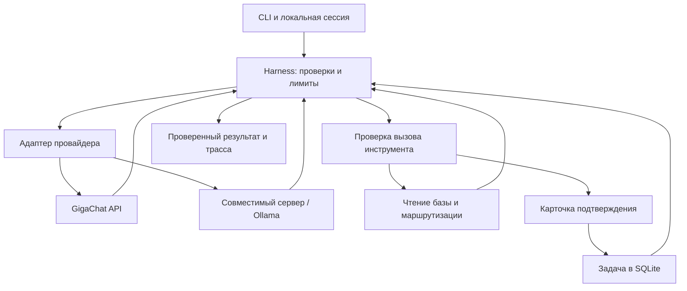

# Архитектура

## Границы

`agent.py` не знает wire-формат конкретного API. `providers.py` преобразует общие сообщения и `Turn` в native GigaChat или OpenAI-compatible формат. Native `functions_state_id` сохраняется в истории. Выбор провайдера и модели осуществляется конфигом. Заглушка — отдельный явно обозначенный backend исключительно для тестов.

`Executor` — единственная точка исполнения инструментов. Реестр разрешает ровно три функции. Pydantic запрещает неизвестные поля и проверяет типы/границы. Права и контекст объекта берутся из `Session`. Чтения ограничиваются таймаутом и повторами. Действие проходит trusted callback подтверждения, затем уникальную запись SQLite. Модель не управляет callback, путями файлов, организацией или идентификатором.

`Agent.check_decision` проверяет наличие и тематическую согласованность источников, наличие маршрута, отсутствие выдуманных source IDs/URL и основание высокого приоритета. `recipient` и ссылки собирает приложение. JSON-схема обеспечивается валидацией ответа и ограниченным циклом исправления, а не неподтверждённым обещанием strict generation конкретного провайдера.

`Store` сохраняет карточки и задачи между запусками. Идемпотентность опирается на `UNIQUE(organization, request_id)`, а не на сгенерированный LLM ключ. Случайный ID нового запуска означает новое обращение; для повтора того же обращения CLI поддерживает `--request-id`.

## Наблюдаемость

JSONL-события: start, model, tool_retry, tool, provider_retry, provider_error, answer_rejected, persistence_error, final. Записываются реальные вызовы и их результаты, а не скрытые рассуждения модели. Есть длительность инструмента, количество попыток, актор подтверждения, входные/выходные токены. Секреты и распространённые идентификаторы маскируются, runtime исключён из Git. Цена считается только при задании реальных ставок тарифа; иначе `estimated_cost=null`.

## Надёжность и известные пределы

Timeout чтения выполняется через `asyncio.wait_for`; фоновое чтение файла может завершиться после отмены, но оно не меняет состояние. Запись задачи выполняется синхронной ограниченной SQLite-транзакцией и не повторяется вслепую. Подтверждение предназначено для доверенного локального CLI. Набор regex не обнаруживает любые возможные персональные данные или атаки; приложение не является многопользовательским авторизованным сервисом.
